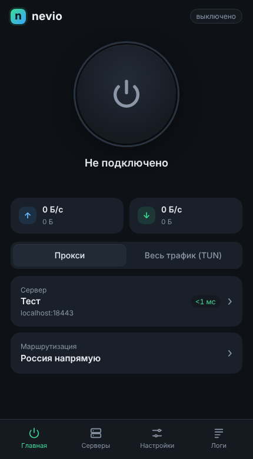

# cypher

Прокси-протокол, который прячется от DPI: снаружи это обычный HTTPS к обычному
сайту, а маршрутизация на клиенте настраивается правилами в стиле Xray с теми же
файлами `geosite.dat` / `geoip.dat`.

## Как это работает

```
[Windows: браузер, программы, игры]
        │  TUN (весь трафик) или SOCKS5 127.0.0.1:10808 / HTTP 127.0.0.1:10809
        ▼
  cypher.exe ── маршрутизатор (geosite/geoip) ──► direct / block
        │
        └── proxy: TLS 1.3, отпечаток Firefox ──► [Linux: cypher, порт 443] ──► интернет
                                                    └─ без ключа: обычный сайт
```

* **Настоящий TLS 1.3** к вашему домену с настоящим сертификатом. SNI, IP,
  сертификат и сайт согласованы.
* **Отпечаток браузера**: ClientHello настоящего браузера через uTLS: по умолчанию Firefox, можно Chrome, Safari и другие.
* **Защита от активного зондирования**: без валидного ключа сервер отдаёт
  обычный сайт по HTTP/1.1 и HTTP/2. Повторы записанного трафика отвергаются.
* **Маскировка размеров**: начало каждого потока (там, где идёт рукопожатие
  внутреннего TLS) режется на куски случайного размера с паддингом.
* **Поведение как у браузера**: пул из нескольких TLS-соединений с ротацией
  по случайному времени и объёму, закрытие в простое.
* **Правила без перезапуска**: `geosite.dat`, `geoip.dat` и `routing`
  перечитываются на лету.
* **Маршрутизация как в Xray**: `geosite:`, `geoip:`, `domain:`, `full:`,
  `regexp:`, порты, `IPIfNonMatch`.

Подробности: [протокол](docs/protocol.md) · [установка](docs/setup.md) · [клиент nevio для Windows](docs/nevio.md) · [отличия от Xray и план против блокировок](docs/comparison.md).

<picture>
  <source media="(prefers-color-scheme: dark)" srcset="docs/images/nevio-logo-dark.png">
  
</picture>

**nevio** — клиент для Windows:



## Быстрый старт

Готовые сборки — в [Releases](https://github.com/ddday9/cypher/releases):
клиент для Windows `nevio-windows-amd64.exe` и образ сервера
`ghcr.io/ddday9/cypher`.

Сервер на Linux в Docker ([подробно](docs/docker.md)):

```bash
cd deploy/docker && echo "CYPHER_DOMAIN=example.com" > .env && docker compose up -d && docker compose logs cypher
```

Сборка из исходников:

```bash
make linux windows
```

```bash
./bin/cypher-linux-amd64 genkey
```

Сервер: `examples/server.json`. Клиент: `examples/client.json`. Запуск:

```bash
cypher run -c config.json
```

## Статус

Готово:
- [x] Перечитывание geo-файлов и правил на лету
- [x] Этап 2: пул соединений, ротация, паддинг начала каждого потока
- [x] UDP через туннель, SOCKS5 UDP ASSOCIATE
- [x] Скрипты установки сервера и проверки клиента
- [x] Режим TUN (Windows/Linux): весь трафик, перехват DNS, сниффинг доменов
- [x] Протокол v2 (совместим с v1 в обе стороны), распознавание заморозки соединений
- [x] Режим «против заморозки»: сессия поверх коротких соединений ниже порога ТСПУ
- [ ] Ретранслятор внутри страны (цепочка серверов) — задел в протоколе
- [ ] Форма трафика против классификаторов вложенного TLS, транспорт поверх HTTP/2
- [x] Графический клиент для Windows: серверы, подписки, ссылки cypher://, трей, системный прокси, TUN

## Разработка

```bash
make test
```

Проверка на настоящих geo-файлах Xray:

```bash
CYPHER_GEO_DIR=/path/to/dat go test -run RealGeo ./internal/router/
```
