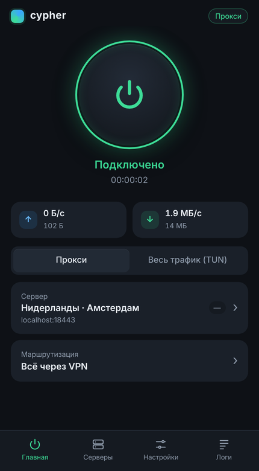
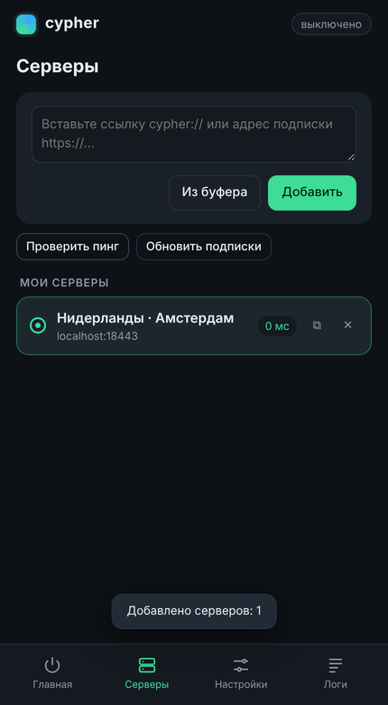
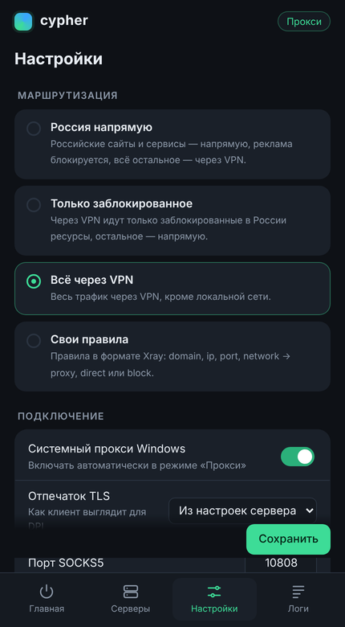

# Клиент для Windows (cypher-gui)

<p>



</p>

## Установка

1. Соберите `cypher-gui.exe` (на любой машине с Go 1.26+, например на Linux-ВМ):

```bash
make gui
```

   `make` скачает `wintun.dll`, проверит его SHA-256 и встроит в exe. Значок
   и манифест для exe (необязательно, нужен доступ к интернету):

```bash
make gui-icon gui
```

2. Положите `bin/cypher-gui.exe` в любую папку, например `C:\Program Files\cypher\`
   или `%LOCALAPPDATA%\cypher\`, и запустите. Нужен WebView2 Runtime — он уже
   есть в Windows 10/11; если его нет, интерфейс откроется в браузере.

## Как пользоваться

1. **Серверы → вставьте ссылку** `cypher://…` (её печатает
   `install-server.sh`, или `cypher link -server … -key …`) **или адрес
   подписки** `https://…` → «Добавить».
2. **Главная → большая кнопка.** В режиме «Прокси» cypher сам включает
   системный прокси Windows и возвращает прежние настройки при отключении
   (даже после аварийного завершения — при следующем запуске).
3. **Весь трафик (TUN)** — через cypher идут все программы, включая игры и UDP.
   Нужны права администратора: при первом подключении cypher предложит
   перезапуститься с ними (Windows покажет запрос UAC).
4. Закрытие окна сворачивает cypher в трей. В меню значка: открыть,
   подключить/отключить, переключить TUN, выход.

При первом подключении загружаются базы geosite/geoip
([runetfreedom/russia-v2ray-rules-dat](https://github.com/runetfreedom/russia-v2ray-rules-dat),
около 100 МБ), затем раз в сутки обновляются сами — без переподключения.

## Маршрутизация

| Пресет | Что делает |
|---|---|
| Россия напрямую | российские сайты и IP — напрямую, реклама блокируется, остальное — через VPN |
| Только заблокированное | через VPN только `geosite:ru-blocked` и `geoip:ru-blocked`, остальное напрямую |
| Всё через VPN | всё, кроме локальной сети |
| Свои правила | JSON в формате Xray, см. [setup.md](setup.md#маршрутизация) |

## Подписки

Подписка — это URL, который отдаёт список ссылок `cypher://` (по одной в
строке) или тот же список в base64. Серверы подписки обновляются кнопкой
«Обновить подписки»; выбранный сервер сохраняется, если он остался в списке.

## Где лежат данные

`%APPDATA%\cypher\`: `state.json` (серверы и настройки), `geosite.dat`,
`geoip.dat`, `cypher.log`, `webview2\` (данные окна).

## Ограничения

* Проверено: весь интерфейс и связка с ядром — в браузере на Linux (импорт,
  пинг, подключение, трафик, смена пресета, логи). Окно WebView2, трей,
  системный прокси, автозапуск и перезапуск с правами — код для Windows,
  который собирается, но не запускался на настоящей Windows.
* Автозапуск через реестр стартует cypher без прав администратора: в режиме
  TUN при автозапуске будет запрос UAC.
